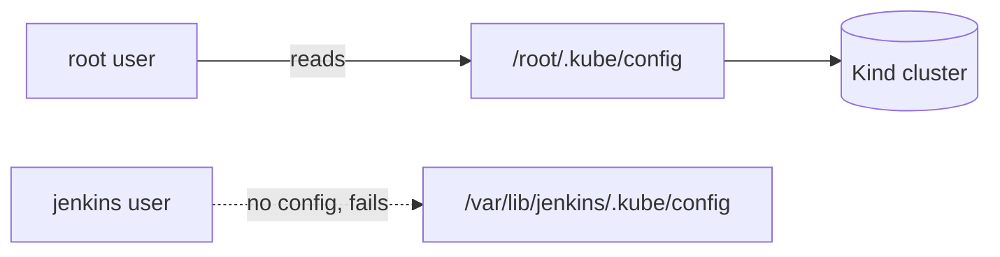

# Jenkins + Kubernetes (Kind): Fixing "Jenkins Can't Access the Cluster"

Your Jenkins pipeline builds a Docker image and deploys it to a local Kind cluster using `kubectl`. This guide explains why the deploy step fails and how to fix it in 2 minutes.

---

## 1. The Problem

The pipeline works until the deploy stage, then fails:

```text
error: Couldn't get current server API group list
permission denied
```

### Why it happens

`kubectl` needs a **kubeconfig** file. It tells `kubectl` where the cluster is and holds the certificates to log in.

| Who runs `kubectl` | Where it looks for the config | Result |
|---|---|---|
| You, as `root` in the terminal | `/root/.kube/config` | Works |
| Jenkins, as the `jenkins` user | `/var/lib/jenkins/.kube/config` | **File does not exist, so it fails** |



Jenkins is a separate system user. It does not share `root`'s files, so it cannot see the cluster.

---

## 2. The Fix

Give the `jenkins` user its own copy of the kubeconfig. Run on the Ubuntu host:

```bash
# 1. create the .kube folder in Jenkins' home
sudo mkdir -p /var/lib/jenkins/.kube

# 2. copy the working config
sudo cp /root/.kube/config /var/lib/jenkins/.kube/config

# 3. make jenkins the owner
sudo chown -R jenkins:jenkins /var/lib/jenkins/.kube

# 4. only the owner may read it (it contains certificates)
sudo chmod 600 /var/lib/jenkins/.kube/config
```

No restart of Jenkins is needed.

---

## 3. Test It

Always test **as the jenkins user**. Testing as `root` proves nothing, because `root` always worked.

```bash
sudo -u jenkins kubectl get nodes
```

Expected:

```text
NAME                       STATUS   ROLES           AGE   VERSION
my-cluster-control-plane   Ready    control-plane   1d    v1.30.x
```

`Ready` means Jenkins can now talk to the cluster.

---

## 4. Use It in the Pipeline

Nothing special is needed in the Jenkinsfile. `kubectl` automatically finds `/var/lib/jenkins/.kube/config`:

```groovy
stage("applying k8s manifests !!") {
    steps {
        sh '''
            kubectl apply -f Working-W-Jenkins/Docker-Kubernetes-Jenkins/deployment.yml -n myspace
            kubectl get all -n myspace
        '''
    }
}
```

Run the job with **Build Now**, then check from the host:

```bash
kubectl get all -n myspace
```

---

## 5. Alternative: Keep the Config Inside Jenkins

Use this if you would rather not keep a copy on disk.

1. **Manage Jenkins > Credentials > Add Credentials**
2. Kind: **Secret file**, upload `/root/.kube/config`, ID: `kubeconfig`
3. Use it in the pipeline:

```groovy
stage("applying k8s manifests !!") {
    steps {
        withCredentials([file(credentialsId: 'kubeconfig', variable: 'KUBECONFIG')]) {
            sh 'kubectl apply -f Working-W-Jenkins/Docker-Kubernetes-Jenkins/deployment.yml -n myspace'
        }
    }
}
```

| | Copy to `.kube` (section 2) | Secret file credential |
|---|---|---|
| Setup | 4 commands | Upload once in the UI |
| Jenkinsfile change | None | Wrap in `withCredentials` |
| Best for | Quick lab setup | Cleaner, easier to rotate |

---

## 6. Common Errors

| Error | Cause | Fix |
|---|---|---|
| `Couldn't get current server API group list` | Jenkins has no kubeconfig | Do section 2 |
| `connection refused` to `127.0.0.1:<port>` | Kind cluster was stopped or recreated (new port and certificates) | Copy the kubeconfig again |
| `kubectl: command not found` | kubectl not installed or not in the Jenkins PATH | Install kubectl on the host |
| `namespaces "myspace" not found` | Namespace missing | `kubectl create namespace myspace` |
| Works in terminal, fails in Jenkins | You tested as `root` | Test with `sudo -u jenkins kubectl get nodes` |

---

**Author:** Shubham Mali | [@Shubhamx18](https://github.com/Shubhamx18)
